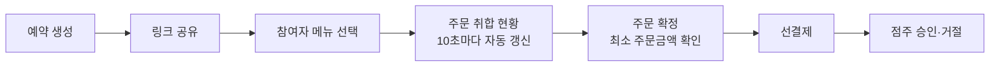
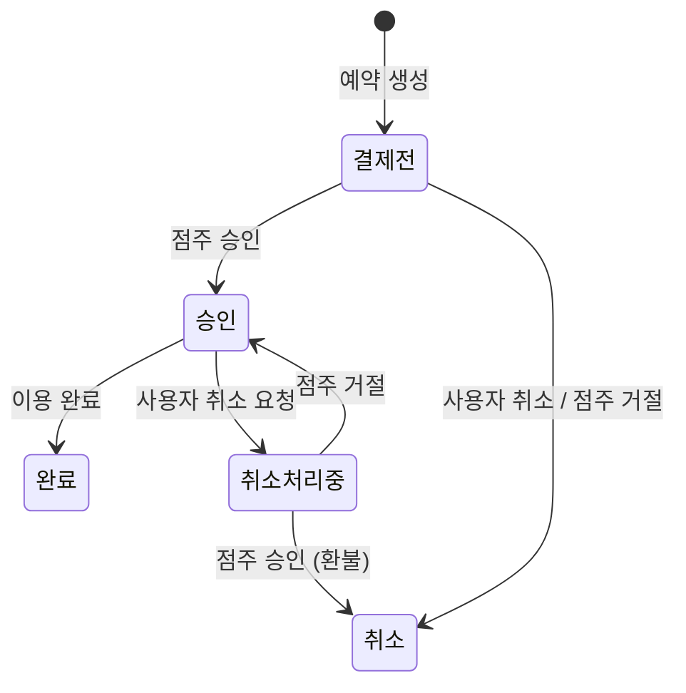

# everytable

# 에브리테이블 (EveryTable)

단체 예약 선결제 기반 카페·식당 픽업 주문 플랫폼

> 부트캠프 최종 프로젝트 · 2026.07 ~ 2026.08 · 4인 팀
> 이 저장소는 팀 프로젝트를 Fork한 것이며, 저(이혜원)는 **PL과 예약·주문(reservation) 파트**를 맡았습니다.

## 소개

전화로 주고받던 단체 도시락·음료 주문을 온라인으로 옮긴 서비스입니다.

1. 대표자가 매장과 방문 날짜·시간을 정해 예약을 만듭니다.
2. 생성된 링크를 공유하면 참여자들이 각자 원하는 메뉴와 옵션을 고릅니다.
3. 대표자가 모인 주문을 확인하고 확정한 뒤 선결제합니다.
4. 점주는 주문을 승인하거나 거절하고, 취소 시점에 따라 환불이 처리됩니다.

한 번 Servlet + JSP + Oracle로 만들었던 프로젝트를 Spring Boot + React 구조로 다시 만들었습니다.

## 팀 구성

| 이름 | 역할 | 담당 |
| --- | --- | --- |
| 원주현 | PM | 매장·메뉴 관리, 점주 권한 분리 |
| **이혜원** | **PL** | **예약·주문 프로세스 (백엔드 + 프론트엔드)** |
| 정시은 | 서기 | 결제·환불, 일별 매출 집계 |
| 주연오 | DBA | 회원·공지사항·리뷰·통계 |

## 기술 스택

| 구분 | 기술 |
| --- | --- |
| Backend | Java 17, Spring Boot 3.5, Spring Data JPA, QueryDSL, Spring Security, JWT |
| Frontend | React 19, Vite, React Router, axios |
| Database | MariaDB |
| Tools | Git/GitHub, IntelliJ, VS Code |

## 주요 기능

| 사용자 | 기능 |
| --- | --- |
| 일반 사용자 | 회원가입·로그인, 매장·메뉴 조회, 단체 예약과 메뉴 선택, 선결제, 환불 신청, 리뷰 작성 |
| 점주 | 매장·메뉴 등록과 수정, 품절 처리, 주문 승인·거절, 취소 요청 처리, 매출 통계 |
| 관리자 | 회원 관리(등급·정지), 공지사항 관리, 전체 예약·결제 관리, 통계 조회 |

## 내가 맡은 부분: 예약·주문

### 단체 주문 흐름



- 자기 매장에는 예약할 수 없도록 막았습니다.
- 참여자는 옵션(필수/복수 선택)과 메뉴별 요청사항을 넣어 장바구니에 담습니다.
- 취합 화면에서는 같은 메뉴·같은 옵션끼리 수량을 합쳐 보여줍니다.
- 최소 주문금액은 화면뿐 아니라 서버에서도 한 번 더 확인합니다.

### 예약 상태 관리

예약은 5단계 상태로 관리하고, 상태를 바꾸는 요청이 오면 지금 상태에서 가능한 변경인지 서버에서 먼저 확인합니다.



### DB 설계

- `reservation`: 예약 1건 (대표자, 매장, 날짜·시간, 인원, 상태, 총액, 매장 요청사항)
- `orders`: 참여자가 담은 메뉴 1개당 1행 (예약, 메뉴, 수량, 가격, 옵션, 요청사항)
- 주문할 때의 메뉴 가격을 `orders`에 따로 저장해서, 점주가 나중에 가격을 바꿔도 이미 들어온 주문 금액은 바뀌지 않게 했습니다.

### 트러블슈팅

**1. 같은 메뉴를 다른 옵션으로 담으면 한 줄로 합쳐지는 문제**
- 원인: 취합할 때 메뉴 번호와 가격을 기준으로 묶고 있었습니다.
- 해결: 메뉴 번호와 선택 옵션을 기준으로 묶도록 바꾸고, 요청사항은 중복을 빼고 함께 보여줬습니다.

**2. 옵션을 고르지 않고 담으면 화면이 멈추는 문제**
- 원인: 단일 선택 옵션을 고르지 않으면 값이 `null`인데, 이 값을 읽으려다 오류가 났습니다.
- 해결: 복수 선택과 단일 선택을 나눠 처리하고, 비어 있는 값은 건너뛰게 했습니다.

**3. 예약 목록 조회 쿼리가 너무 많이 나가는 문제 (N+1)**
- 원인: 예약마다 회원 이름, 매장 이름을 따로 조회해서 10건에 쿼리가 약 40번 나갔습니다.
- 해결: 필요한 ID를 먼저 모아 한 번에 조회한 뒤 Map으로 맞춰서, 10건 기준 4~5번으로 줄였습니다.

### 아쉬운 점

- 점주 승인·취소 승인 때 결제 처리에서 난 오류를 무시하고 있어서, 결제가 실패해도 예약 상태만 바뀔 수 있습니다.
- 취합 현황과 상세 화면은 메뉴 이름을 아직 한 건씩 조회합니다.
- 예약 상태를 숫자(1~5)로 다루고 있어서 enum으로 바꾸고 싶습니다.

## 프로젝트 구조

```
springbootProject
├── everytable_back    # Spring Boot API 서버
└── everytable_front   # React (Vite) 화면
```

## 실행 방법

### Backend

1. MariaDB에 `everytable` 데이터베이스를 만듭니다.
2. `everytable_back/src/main/resources/application.properties`에 DB 접속 정보, JWT 시크릿 키, 메일 계정 정보를 넣습니다.
3. 실행합니다. (기본 포트 80)

```bash
cd everytable_back
./mvnw spring-boot:run
```

### Frontend

```bash
cd everytable_front
npm install
npm run dev
```

브라우저에서 `http://localhost:5173`으로 접속합니다.

## 포트폴리오

프로젝트를 더 자세히 정리한 내용은 [포트폴리오](노션_링크)에서 볼 수 있습니다.
